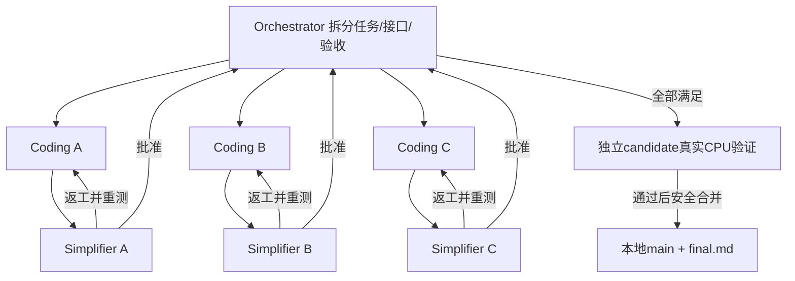

# H3 单节点8卡 MVP 开发工作流

- Workflow ID：`wf-2026-10-27-h3-8gpu-mvp-dev-001`
- 实际源码仓库：`framecode`，不是外层报告仓库或旧inputs。
- 定义：[workflow.json](workflow.json)；总需求：[task.md](task.md)。
- 源码初始基线：`d818b8a231b52a9a024fa2f522057acdbb7bf099`；之后的任务准备提交只添加工作流材料。
- 实时状态以工具run记录为准；此README不是完成证明。

Orchestrator可只激活一组顺序开发；parallel-wave仅在明确不重叠的文件/接口边界后使用。并行的coding完成后，分支暂存在run内汇合供三个对应simplifier检查，不提前发布main。每个角色持久会话复用，空闲角色不编造任务。

角色handoff时由原工作流引擎生成实际Git提交，每项应为经过测试的原子功能；orchestrator负责批准、返工、范围和最终合并决策。框架会在最终独立candidate真实重跑七项Flash CPU回归、H3针对性CPU集及diff检查。

## 文件

- `plan.md` / `assignments/{a,b,c}.md`：orchestrator动态任务划分。
- `coding-{a,b,c}/`：各原子任务代码/测试交付。
- `simplifier-{a,b,c}/`：对应审查与返工依据。
- `merge-ledger.md`：任务与提交/审核的对应关系。
- `final.md`：最终实现、测试、未决GPU门禁及使用说明。
- `reference/`：只读历史设计、硬件、上游片段及许可，不是可导入的生产依赖。

## 操作方式

使用工具自带的`src/cli.ts`并显式传入framecode根目录，避免当前主会话位于外层报告仓库而误选Git目标。这与project_workflow调用同一个WorkflowEngine/operate，不绕过Git检查、权限、提交或integration验证。start CLI会等待run结束；主会话持有进程PID和日志，后续操作JSON用相同CLI的status/pause/resume等动作。

只本地开发/CPU验证；不push、不访问服务器、不运行GPU任务。实际8卡H3验收仍需独立授权和环境/资源材料。
