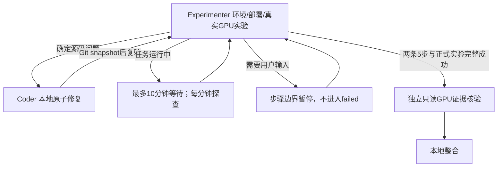

# H3 真实实验闭环

Workflow ID：`wf-2026-10-28-h3-experiment-cycle-001`。



- [task.md](task.md)：职责、授权、执行和验收规则。
- [formal-plan.json](formal-plan.json)：既定正式配置；更新次数尚待用户确认，不将40步pilot擅自视为大型实验。
- [workflow.json](workflow.json)：定义，两个持久角色，无额外子代理。
- `state.json`：Experimenter的当前阶段/owned job。
- `issues/`、`coder/`、`experimenter/`：真实错误及反馈修复记录。
- `evidence.json`、`final.md`：最终真实实验交付（尚未生成时不表示完成）。

## 后台监视

主会话从framecode根启动官方workflow CLI，并另起监视进程。监视器约每60秒查询workflow和owned jobs，状态与告警保存在：

```text
framecode/.pi/workflow-tmp/h3-experiment-cycle-001/monitor.json
framecode/.pi/workflow-tmp/h3-experiment-cycle-001/monitor-events.jsonl
```

监视窗口最长48小时；工作流总预算24小时，角色/步骤预算另有限制。只在纯模型网络错误、当前工具回执完整、无未知外部操作且worktree可核查时最多两次续接；不接受伪成功、不重放未知SSH动作、不自动杀其他进程。长GPU任务本身有显式硬超时，Experimenter需合理设置并记录。主机休眠/网络故障可能中断观察，不承诺绝不卡死。

## 操作与日志

固定SSH入口和远端root由operations.py定义。远端仅使用Git部署的新source/<SHA>，输出位于独立runs/<job-id>，原checkpoint/数据/进程不覆盖。所有命令带唯一操作id并保留原始结果，重复id不重新执行；未知mutating操作先核查再reconcile。

角色只能使用声明的operations.py入口；脚本不是安全沙箱，仍必须按task审查命令副作用及路径。部署与训练状态以真实返回为准。本地语法检查与GPU完成证据检查均不是CPU训练回归。
